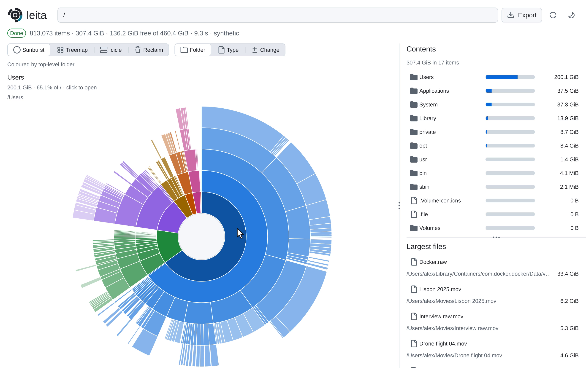

<p align="center">
  <picture>
    <source media="(prefers-color-scheme: dark)" srcset="branding/hero-dark.svg">
    
  </picture>
</p>

<p align="center"><b>leita</b> <i>(Old Norse, verb)</i> — “to search, to seek.”</p>

<h3 align="center">A disk space analyzer for Linux, Windows, and macOS.</h3>

<p align="center">Find what’s filling your disks, see what changed, and share the answer.</p>

<p align="center"><b>Free for everyone, including organisations</b> · Pro for tracking, automation and reports · source published · no telemetry</p>
<p align="center"><a href="https://mordaunt.dev/leita/">Download Leita, a disk space analyzer for Linux, Windows and macOS</a> · <a href="https://mordaunt.dev/leita/buy/">Plans and pricing</a></p>

<p align="center">
  <a href="branding/demo.mp4"></a>
  <br><a href="branding/demo.mp4">▶ Watch the 38-second demo</a>
</p>

---

## Answers in seconds, not minutes

Point leita at a drive and the picture of it starts filling in at once. You
don't wait for a scan to finish: the chart grows as leita reads the disk,
and you can start exploring while the rest arrives.

- **Three ways to see it:** sunburst, treemap and icicle. Switch at any time.
- **Click to dig in:** open any folder to see what fills it.
- **Any drive or folder:** your laptop, a server, an external disk or a disk image.

Sizes are the space a file takes on disk, in the decimal units disks are sold
in: 1 GB is 1,000,000,000 bytes. On a Mac, a sparse disk image or a compressed
file is charged what it occupies, not its length.

## Reports that make the case

Turn any scan into a file from **Export** in the settings menu. **CSV** and
**JSON** of the current scan are free. **PDF**, for the person who signs off
on a new disk, and **HTML**, to share, are Pro reports. Each lists the largest
folders and files, and how full the disk is. It lists what can be cleaned up
when you ask it to.

A CSV or JSON of the current scan, written with no licence and no earlier scan
attached, ends with: Free export of the current scan. When an earlier scan is
kept and not compared, the CSV says so. A PDF or HTML made during the 30-day
Pro evaluation, with no licence, ends with: Unlicensed copy made during the
30-day Pro evaluation.

A PDF embeds the glyphs it draws. It takes a sans font from the machine when
that font may be embedded, and otherwise Liberation Sans, which leita carries,
for Latin, Greek and Cyrillic. Other scripts come from a font on the machine,
so a PDF is not refused for want of a font.

## See what changed

leita keeps the 30 newest scans of each place. A scan stores an entry only
when it holds at least 1 MiB. Scan the same place again and leita shows what
grew and what shrank among the entries it kept.

A place read before is read again only where it changed. leita keeps the whole
tree of that place beside the scans, and asks the system what changed since:
the change journal on macOS and Windows, each folder's modification time on
Linux. When the system cannot say, or too much has happened since, leita reads
the place whole and tells you why. A file written in place, in a folder the
update does not read again, is measured again on macOS and Linux: one of 1 MiB
or more at every scan, a smaller one within 8 scans. On Windows a file held
open across scans can keep its old size until the next whole read.
On Linux a place last read whole over 7 days ago is read whole the next time.
`leita --whole` reads everything again. `--no-history` neither uses that tree
nor keeps the scan.

A tree no scan has rewritten in 30 days is deleted. The next scan of that
place reads it whole.

Linux keeps no record of what changed while nothing was listening, so there
leita asks each folder when it last changed. `sudo leita journal on`, or
Record changes as they happen in the window's Monitoring, installs a recorder:
the system service leita-journal, running a root-owned copy of leita, with only
the two capabilities fanotify needs. From the release archive that copy is
`/usr/local/libexec/leita/leita`. A `.deb` or `.rpm` installs its own at
`/usr/libexec/leita/leita`, and `leita journal on` only enables the service.
The recorder is off until you turn it on. `leita journal off` stops it and
removes its logs, and removes the service too unless a package installed it.
The logs, one file a filesystem in `/var/lib/leita/journal`, hold a hash of
each changed folder's path and when it changed, never the name, and drop what
is older than 30 days. `leita journal status` says which filesystems are
recorded. btrfs subvolumes are not recorded yet, and a scan there asks each
folder as before. A scan on Linux says which it used: "(recorded changes)" or
"(folder times)".

In the window, and on the command line, seeing what changed needs Pro once the
30-day evaluation has ended. The snapshots are kept either way, and so is the
log of what leita deleted.

## Scheduled scans

Have leita scan the places you care about every hour, day or week while it is
closed, so change tracking has a steady record. Open **Monitoring** (in the
settings menu, the gear in the toolbar), add a place, and turn on **Scheduled
scans**. Each scan runs gently, at low priority, and is kept like any other
scan.

leita keeps nothing running: it hands one hourly entry to your system's own
scheduler (a systemd user timer on Linux, a Task Scheduler task on Windows, a
launchd agent on macOS), which starts `leita monitor run`, scans whatever is
due and exits. Turning monitoring off removes that entry; nothing runs unless
you turn it on. The same is there from the terminal:

```sh
leita monitor add ~/Projects --every daily
leita monitor on
leita monitor list
leita monitor off
```

Each watched place can raise an alert: when its disk passes a percent used or
falls under a free space you set, when it is forecast to fill within some
days, from the scans kept so far, or when the place grows far faster than it
has been. An alert shows once, as a desktop notification and in Monitoring,
the scan it first appears, and again only after it has cleared:

```sh
leita monitor add D: --warn-used 80 --fail-used 95 --min-free 20GB --full-within 14 --growth
```

Scheduled scans and their alerts need Pro, with the same 30-day evaluation.
Turning them off, and removing a place, does not.

## Free up space, safely

Reclaim lists a folder only when a rule proves what it is and that it will be
made again: build output, installed dependencies, Python caches and
environments, downloaded packages, application caches it knows by name, and
the Trash. On a Mac that list also has Xcode's DerivedData and device support,
the simulator's cache at `Library/Developer/CoreSimulator/Caches`, Chrome's
cache, caches under `Library/Caches` that are on its list, and your Trash on
another volume, at `/Volumes/<name>/.Trashes/<your numeric user id>`.
Nothing under a system directory is listed, and nothing inside `.git`.

Time Machine, iPhone backups, Xcode archives, the simulators' disks, and
Docker's or OrbStack's virtual disk are not rules. A folder inside them is
listed only when a rule matches it.

Each item shows how much it frees and why it is safe to delete.

Each deletion leita makes is recorded: the path, how big it was, when, and
whether it failed. Scans older than the newest 30 are forgotten. This record
is kept. Read it in the window under History in the settings menu, or with
`leita history`, newest first; `--since DATE` and a folder narrow it and `--json`
writes it for a program.

## Private by design

- **No telemetry.** leita sends nothing about you or your disks. It reaches
  the network in three cases. Adding a licence key in the window sends one POST to
  `https://mordaunt.dev/leita/activate`; the body holds the key and nothing
  else. When a licence kept on this machine no longer verifies, and the key
  from the receipt was kept beside it, leita sends that key once more, to the
  same address. If that request cannot reach the server, or the server has no
  line, this copy stays free and says so, and the licence already kept stays.
  `leita update`, and Check for updates in About, download files from the
  latest release on GitHub, `releases/latest/download`: a GET for
  `sha256sums.txt`, `version.txt` and, if you ask for the update, the new
  program. These requests carry the User-Agent `leita/<version>` and nothing
  from your machine. `leita licence add` keeps a licence you already have and
  sends nothing. The source is published, so you can check.
- **No account.** On Linux the release needs glibc 2.39 or newer and
  libstdc++. The window carries SDL3. libcurl is opened only for that POST
  and for an update you ask for, and leita runs without it. Windows's zip carries `SDL3.dll` and
  `accesskit.dll` beside the window.
- **Your data stays with you.** Scans, settings and the deletion record stay
  on your machine.

## Get started

Open **Leita** and pick a drive or folder. On Windows, running as an
administrator lets a scan of an NTFS volume read the Master File Table, which
is faster. Without that, leita walks the volume.

**Linux.** The release is built on Ubuntu 24.04. It needs glibc 2.39 or newer
and libstdc++, so it runs on Ubuntu 24.04 and Fedora 40 and later. Debian 12
has glibc 2.36 and Ubuntu 22.04 has 2.35. `<version>` below is the tag, such
as `v1.2.0`. `<arch>` is `amd64` or `arm64`.

- `leita-<version>-linux-<arch>.tar.zst` holds `leita`, the window `Leita` in
  `app/`, `LICENSE.md` and `THIRD_PARTY.md`.
- `leita-<version>-linux-<arch>.AppImage` is the window as one file.
- `leita-<version>-linux-<arch>.deb` and `.rpm` install `leita` and `Leita` on
  `PATH`, the desktop entry, and the recorder's unit. The short name `le` is
  what `just install` adds. The packages leave it out, because a Debian
  package named `le` already owns `/usr/bin/le`.

**macOS.** Leita needs macOS 11 (Big Sur) or later, on Apple silicon or Intel.
Open `leita-<version>-darwin-universal.dmg` from the release and drag
**Leita** onto **Applications**, then open it from Applications. The app is
signed and notarised by Apple, so the first launch opens it without a trip to
System Settings; macOS then asks before Leita reads your Desktop, Documents,
Downloads or another disk. To scan everything, give Leita **Full Disk
Access** under Privacy & Security, in System Settings (System Preferences
before macOS 13).

**Windows.** Run `leita-<version>-windows-amd64-setup.exe`: it installs to
Program Files with a Start menu entry, and can add `leita.exe` to `PATH`. Or
open `leita-<version>-windows-amd64.zip`, which holds `leita.exe`, and in
`app/` the window `Leita.exe` with `SDL3.dll` and `accesskit.dll` beside it.

Prefer the terminal? `leita` does the same, and writes reports too, under a
licence. `just install` also puts it on `PATH` as `le`:

```sh
leita D: --report usage.pdf
```

`leita -h` lists every option. On a Mac, the command comes inside the app,
at `Leita.app/Contents/Helpers/leita`; link it onto your PATH once:

```sh
sudo mkdir -p /usr/local/bin && sudo ln -sf /Applications/Leita.app/Contents/Helpers/leita /usr/local/bin/leita
```

The window is `Leita.app/Contents/MacOS/Leita`, and it takes the same
arguments: `/Applications/Leita.app/Contents/MacOS/Leita ~ --report usage.pdf`.

## Updating

Nothing updates leita for you, and nothing checks. When you want to know, run
`leita update --check`: it prints this version and the latest release's, and
exits 0 when they match, 2 when a newer one is out and 1 when it could not
ask. `leita update` downloads the new build of the program you ran (a patch
from your build when the release has one), checks it against the sha256 the
release publishes, and replaces the program; run it again to use the new one.
The old program stays beside it as `leita.old`. In the window, About has Check
for updates; a newer release is offered as Update, which replaces the window
the same way, or as Download, the release page, for a copy that is not replaced
in place.

A copy a package manager, an AppImage or the Windows installer put there, and
a copy inside `Leita.app`, is not replaced in place: `leita update` says
where to download the new release instead. A macOS app is sealed by its
signature, so it is replaced whole, by the new disk image. On Linux the
update needs libcurl, which most desktops have. On Windows the running
program cannot be overwritten, so the old one is renamed to `leita.exe.old`
and the next update removes it.

## Where leita keeps things

Scans, settings and the licence stay in one folder on this machine.

- **Linux:** `$XDG_DATA_HOME/leita` when that variable is an absolute path,
  otherwise `~/.local/share/leita`.
- **macOS:** `~/Library/Application Support/leita`.
- **Windows:** `%LOCALAPPDATA%\leita`.

The folder holds `history.db` (the scans and the deletion record),
`baselines/` (the tree of each place, replaced on each scan), `settings.db`
(the language, the theme and the watches), `licence`, `first-use` (when the
trial began) and `monitor.lock`.

The recorder's logs on Linux are `/var/lib/leita/journal`. Monitoring's
scheduler entry is separate: `leita-monitor.service` and `leita-monitor.timer`
under `$XDG_CONFIG_HOME/systemd/user`, or `~/.config/systemd/user` when that
variable is unset or not absolute; the Task Scheduler task `leita\monitor` on
Windows; and `~/Library/LaunchAgents/dev.mordaunt.leita.monitor.plist` on
macOS, with its output in `~/Library/Logs/leita/monitor.log`.

Thumbnails are `leita/thumbnails` under the user cache directory:
`~/.cache` on Linux, or `$XDG_CACHE_HOME` when that is set; `~/Library/Caches`
on macOS; the local application data folder on Windows. One unused for 30 days
is removed, and the folder is kept within 256 MiB.

## Language and theme

The window opens in the light theme. The settings menu switches it to the dark
theme, and the choice is kept.

The language is the first leita offers from LANGUAGE, then from the first of
LC_ALL, LC_MESSAGES and LANG that is set. On Windows it also tries the user's
locale. With none of those, it is English. On a Mac, a window started without
them opens in English. The settings menu can set it to English, Spanish,
Portuguese (Brazil), French, German, Italian, Russian, Japanese, Chinese
(Simplified) or Korean.

## Scripts and monitoring

Alert from your RMM tool the moment a drive passes 90% used, without writing a
report. `--warn-used` and `--fail-used` check the percent used,
`--min-free` checks the bytes still free, and leita exits with a code your
script or RMM tool (NinjaOne, Datto, ConnectWise, ...) can act on:

```sh
leita D: --warn-used 80 --fail-used 95 --min-free 20GB
```

| Exit code | Meaning |
| --- | --- |
| 0 | No limit was crossed |
| 1 | A bad flag, a target that could not be scanned, or another error |
| 2 | A `--warn-used` limit was crossed |
| 3 | A `--fail-used` or `--min-free` limit was crossed |

`leita monitor run` exits 0 when monitoring is off, or when another run holds
the lock and this one stands aside. It exits 1 when a place could not be
scanned or kept, or the command could not do what it was asked. Its codes are
0 and 1. `leita journal` and `leita licence` exit 0 when done and 1 when not.

A one-line summary goes to standard error (`warn: 83.4% used, at or past
--warn-used 80%`); nothing is printed for an OK scan beyond the usual summary.
Add `--report - --format json` to also get the full scan on standard output,
with the verdict in its `thresholds` member (`report/SCHEMA.md`). What leita
prints is plain text in a pipe, a log or an agent's hands; only a person at a
terminal sees it styled, and `--color never` or `LEITA_COLOR=never` keeps it
plain there too.

## Licensing

**Scanning, charts, search, safe cleanup, the deletion log, and a CSV or JSON
of the current scan are free for everyone**, including an organisation.

**Pro** compares scans and growth, runs scheduled scans and their alerts, and
writes PDF and HTML reports. It works for 30 days from the first time you run
leita, so you can try it. That evaluation is not a paid year of updates.

A licence is one of three, and each one unlocks the same Pro features. They
differ in who may use them:

| Licence | A year | Who |
| --- | ---: | --- |
| Personal | $39 | One person, noncommercial use |
| Professional | $99 | One commercial operator, including work on client machines |
| Organisation | $499 | One organisation, internal use at all its locations |

A paid year includes the versions released during it. Cancelling renewal keeps
Pro in those versions after the year ends. A later version runs as Free until
another year is paid. A licence you already have keeps the rights it was sold
with, and it does not expire.

Without the window, `leita licence add FILE` keeps the licence file from your
receipt (or the line in it beginning `leita.`), and `leita licence` shows whose
it is, its tier and the paid-through date. A line keeps Pro for a release made
at or before that date, and a later release runs Free. With no licence, it says
how long the Pro evaluation has left. `leita licence remove` forgets the one
kept here. For a single run, as in a container, set `LEITA_LICENCE` to that
line instead.

To add a licence, choose **Licence** in the settings menu and paste the licence
key from your receipt. The terms are in [LICENSE.md](LICENSE.md).

## Build from source

The executable entrypoints are `cmd/cli` and `cmd/gui`. Package `cli` owns
argument parsing and maps commands to domain operations. The window calls typed
domain operations through `gui/app`; `cmd/gui` first routes terminal invocations
to the same `cli` package. The development hot reload executables live in
`cmd/gui-host` and `cmd/gui-child`.

leita is written in [Odin](https://odin-lang.org) and builds with
[just](https://just.systems). `just deps` fetches the jm submodule and builds
the libraries both binaries link. On macOS and Linux that includes SDL3, built
with cmake, and the window then needs no SDL3 installed. A Mac needs nothing
from Homebrew to run it.

```sh
just build release   # build/release/leita and build/release/app/Leita (.exe on Windows)
just bundle          # on a Mac, build/release/Leita.app around them, unsigned
just install         # the release command line on PATH, as leita and as le
just run             # a debug build of the window, opened on the home directory
just test
just hot             # the debug window, the view reloaded on every edit; no sanitizer, for speed
```

`just` alone lists every recipe.
